# Sparse Chess

An experiment exploring the use of [Sparse Predictive Hierarchies (SPH)](https://ogma.ai/wp-content/uploads/2023/05/SPH_Whitepaper.pdf) as a policy/value head for a chess engine (Lc0).

## Motivation

To explore whether local learning rules, potentially capable of online learning, combined with a biologically inspired architecture, could handle chess evaluation and policy prediction without backpropagation. The ultimate goal is to enable online learning and extreme sparsity, allowing larger models to run on modest hardware.

## Model Architecture

### Encoders

Inspired by [AOgmaNeo](https://github.com/ogmacorp/AOgmaNeo/), the architecture features an ART-based encoder. However, instead of mapping each position to a single category, it maps each local receptive field to a single cell (a.k.a. category) in every column.

### Decoders

Following most of Ogma Corp.'s implementations (see the official [whitepaper](https://ogma.ai/wp-content/uploads/2023/05/SPH_Whitepaper.pdf)), the architecture uses a Dendritic Neural Layer as a decoder.

> **Activation function:** Leaky ReLU

### Common Body

A standard SPH model acts as the main feature extractor, providing the heads with a feature representation of what the board should look like after the best move. The policy head must then identify which legal move produces a board state most similar to this "better board representation," while the value head converts the representation into a Win-Draw-Loss (WDL) probability distribution.

### Heads

The heads are also DNNs, but their architecture is closer to that of standard DNN layers than to that of SPH decoders. However, they inherit much of the decoders' logic, making them very similar to decoders at the implementation level.

### Bottom Encoder

Instead of feeding the common body and heads directly with two visible input layers, the inputs first pass through an encoder so that the decoder only has to work with a single visible layer.

### No Exponential Memory

Exponential memory was deliberately omitted for several reasons:

1. To save computation time and memory.
2. To avoid synchronization issues with Lc0's MCTS.
3. To simplify the model's architecture and codebase.

### Optimizations and Performance Observations

#### Byte Weights

Weights are stored as `u8` instead of `f32` to save memory and increase SIMD throughput. To achieve this in decoders, stochastic rounding is applied to the gradients during training.

#### SMM Cache Spatial Locality Problem

A major performance concern with sparse models is their poor cache efficiency. At the cache-line level, memory access and modification resemble random accesses to a very large array that does not fit in the cache. Consequently, the encoder frequently exhibits cache-miss rates of approximately 30%, making it one of the least suitable operations for the von Neumann architecture and the model's primary computational bottleneck.

However, even though cache locality remains unoptimized, the time saved by skipping large numbers of operations makes the trade-off worthwhile.

#### Parallelization

Flamegraphs and `perft` measurements show that, during the encoder's forward and learning passes and the decoder's forward pass, Rayon's scheduling overhead exceeds the performance gains from parallelization. Therefore, parallelization is used only for the decoder's learning pass and the heads' learning and forward passes.

#### Input CSDR

The input consists of two layers:

1. **Board layer (8×8×13):** Contains the piece placement on the board.
2. **Auxiliary layer (1×6×16):** Contains additional positional information, including castling rights, side to move, and the halfmove clock.

### Hyperparameters

- **Number of layers:** 3
- **Hidden representation dimensions (per layer):** 8×8×128
- **Local receptive field size:** 3×3 (i.e., `r = 1`)

See the beginning of `src/bin/train.rs` for the training and model hyperparameters.

### Model Size

- **Parameter count:** 336,150,528

## Training Methodology

Although SPHs thrive in online-learning contexts, the primary goal was to measure their raw playing-strength potential. To save computation time, the model was trained using supervised learning on chunks of the Lc0 `test80` dataset: 10K games for training and 2K games for validation. Each validation pass sampled 200 games from the validation set.

The same training dataset and methodology were used for the control group.

> **Note:** Just for fun, I added cosine annealing to the SPH's head learning rate. However, this feature yielded no significant gains.

## Control Group

See the [**Sparse Chess Control Group Script**](https://github.com/P1X3R/sparse-chess-control-group).

## Results

### SPH

#### Training Loss

##### Windowed (Mean Loss per 100 Games)

**Windowed Policy CCE**
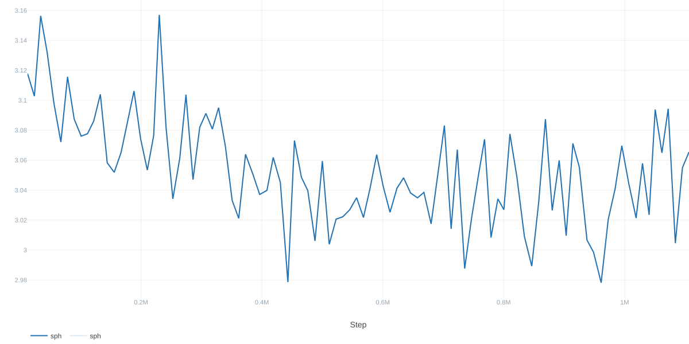

**Windowed Value CCE**
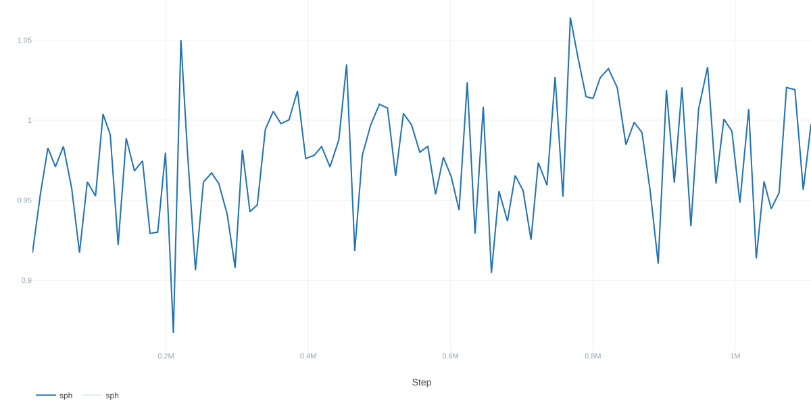

##### Total

**Total Policy CCE**
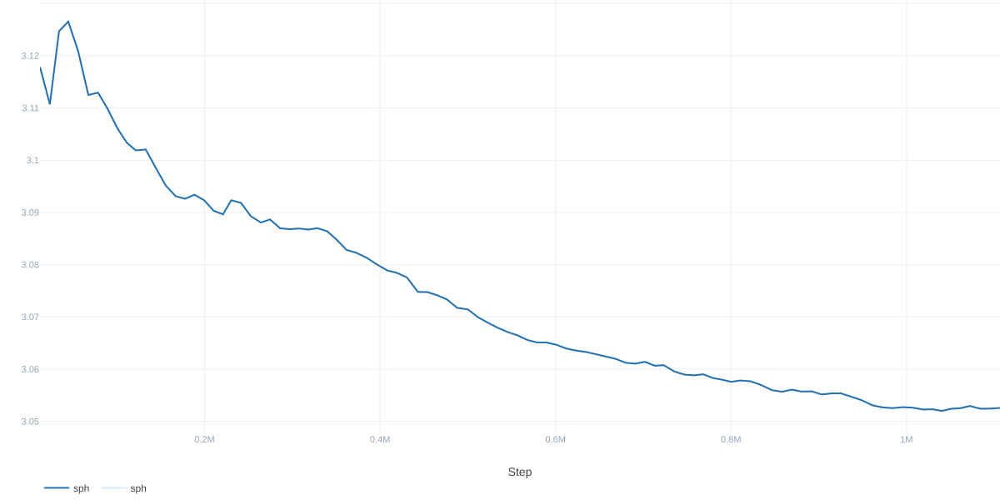

**Total Value CCE**
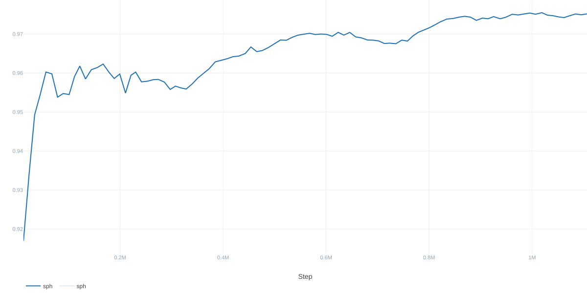

#### Validation Loss

**Validation Policy CCE**
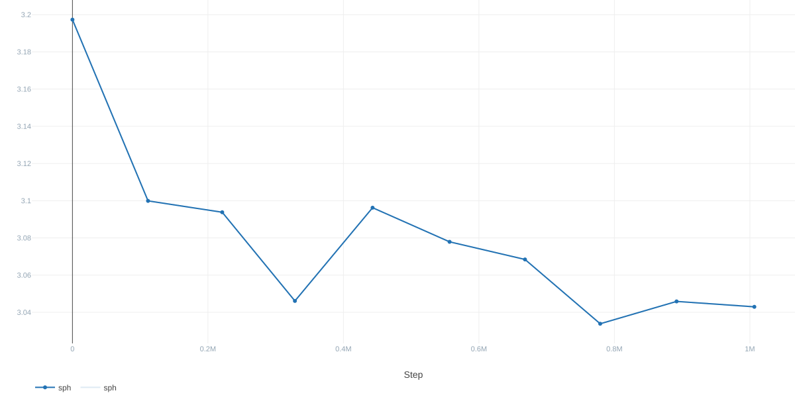

**Validation Value CCE**
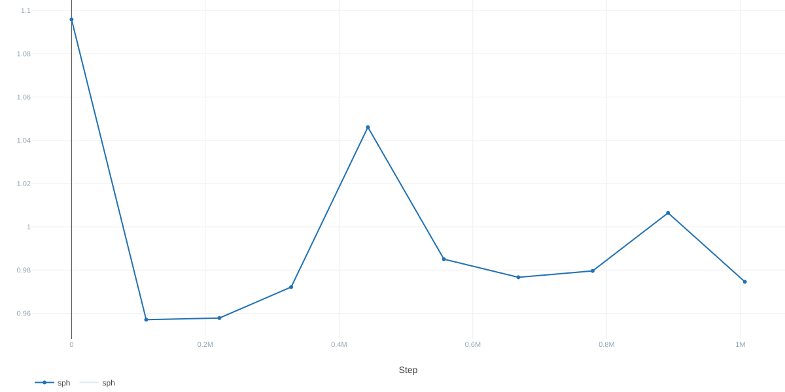

**Validation Top-1 Accuracy**
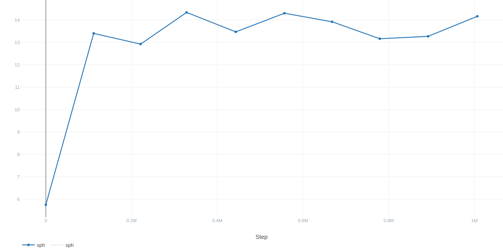

#### Encoder Commitment Rate

**Layer 0 Commitment Rate**
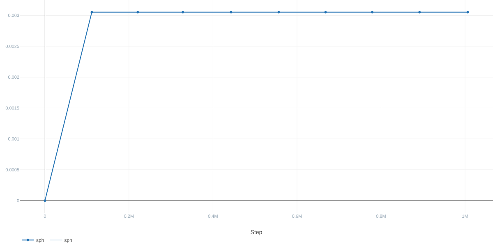

**Layer 1 Commitment Rate**
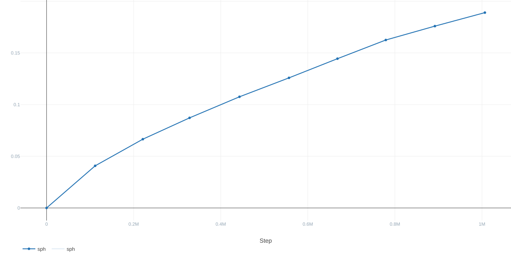

**Layer 2 Commitment Rate**
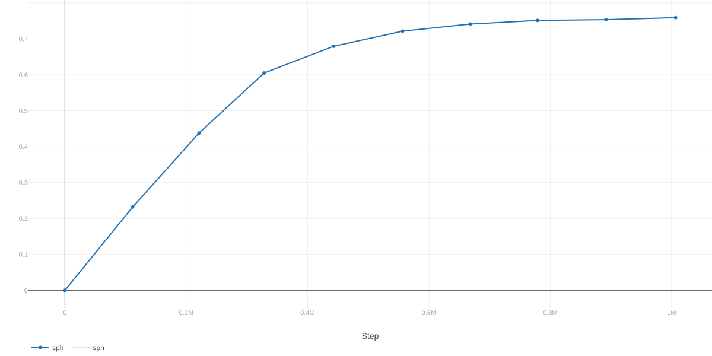

### Control Group (CNN)

> **Note:** Batch size: 256.

#### Training Loss

**Training Policy Loss**
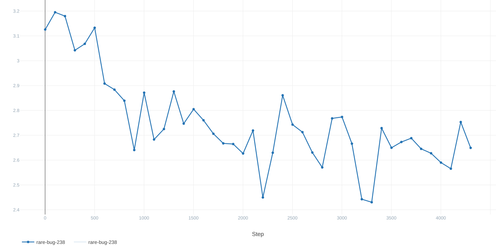

**Training Value Loss**
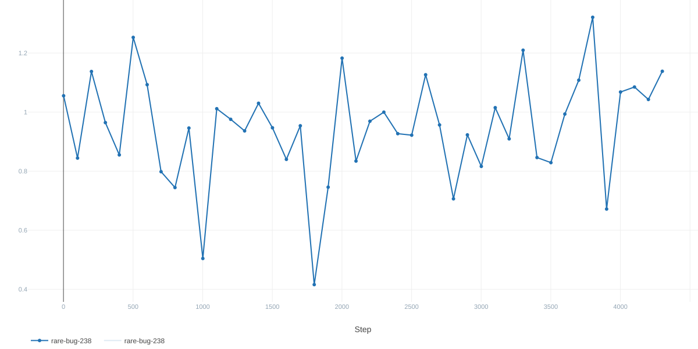

#### Validation Loss

**Validation Policy Loss**
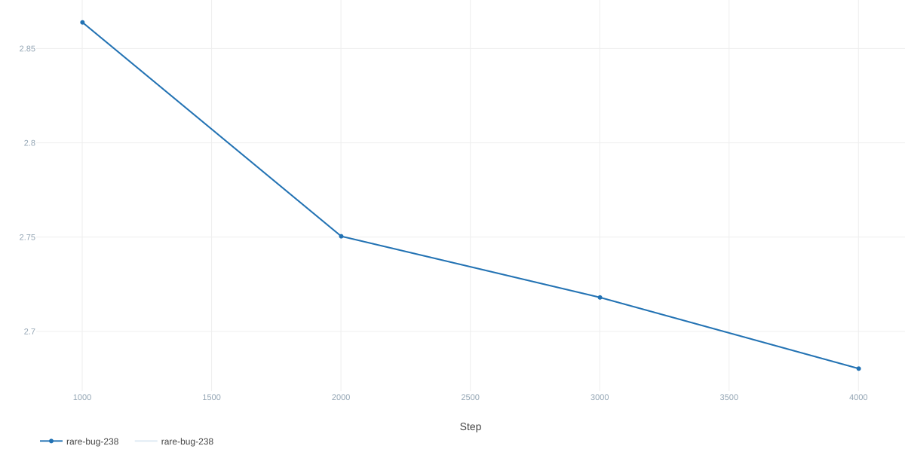

**Validation Value Loss**
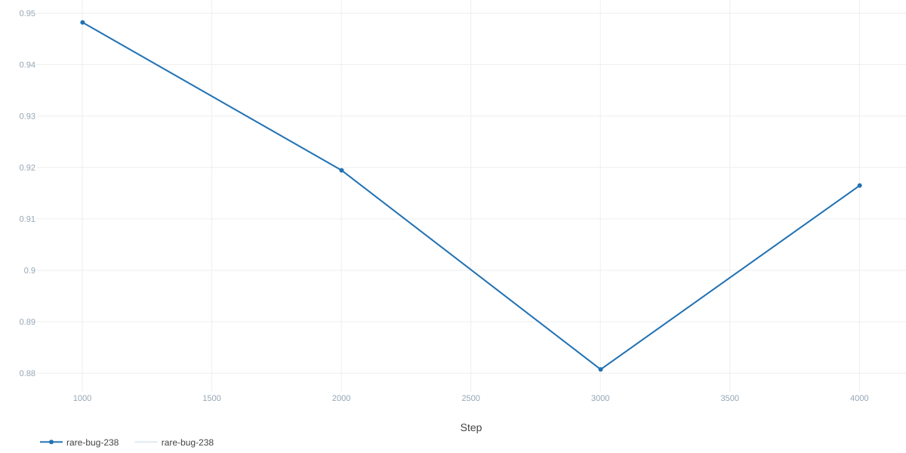

## Conclusion

Unfortunately, the results suggest that the hypothesis was incorrect. This type of model underperforms compared with architectures such as ResNets, Transformers and even plain CNNs in terms of raw chess-playing strength. There are two possible explanations:

1. **Limitations of local learning rules.** Local learning rules may be less effective for feature extraction than backpropagation, which optimizes parameters directly against a shared objective: minimizing the loss on the dataset. Local learning rules instead optimize parameters according to other criteria, such as topological similarity in Fuzzy ART. This limitation might be mitigated in the encoders by using Gaussian ARTMAP.
2. **Information loss due to strict top-1 WTA and CSDR.** This is a trade-off made in favor of speed, preserving approximately 99% sparsity. However, experimenting with top-4 CSDR representations could be worthwhile. This would reduce sparsity to approximately 96%, preserving 4 times more information with just a 4% sparsity reduction, although this estimate is rough.

## How to Replicate

To replicate the experiment, first download one of the chunks from the [Lc0 Training Data Files](https://storage.lczero.org/files/training_data/). Specifically, I used one of the `test80` chunks for this experiment.

### How to Split the Dataset

Split the `.gz` files into `dataset/val/` and `dataset/train/`. Since the paths are hardcoded, you must update them manually in `src/bin/train.rs`.

### How to Set Up the MLflow Server

```bash
mlflow server --host 0.0.0.0 --port 5000
```

> **Note:** The MLflow server address is hardcoded in `src/bin/train.rs`, so you must either modify it or run the server at `http://localhost:5000`. A configuration file is planned for the future to save you a headache. ;)

### How to Run

```bash
cargo run --release --bin train
```
